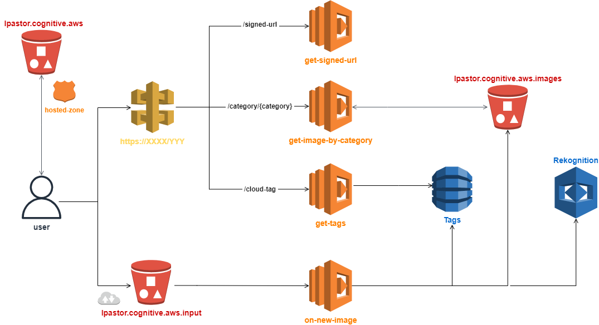

# 🏷️ Tag Cloud — Serverless Image Analysis on AWS

🌐 **[Portfolio (luispastor.dev)](https://luispastor.dev)** &nbsp;|&nbsp; 📝 **[Cloud & Data Blog](https://blog.luispastor.dev/)**

Event-driven serverless web application built on **AWS** that processes uploaded images on demand, automatically extracts descriptive labels using cognitive AI services (**Amazon Rekognition**), and categorizes them for instant search and filtering.

---

## 🏗️ Architecture Overview



### How It Works

1. **Static Web Hosting (`Amazon S3`):** The web interface (`index.html`, `category.html`, `css/`, `js/`) is hosted as a static website on Amazon S3.
2. **Secure Direct Upload (`API Gateway` + `Lambda` + `S3 Pre-signed URLs`):** When a user selects an image to upload, the frontend requests a temporary **S3 pre-signed URL** via **Amazon API Gateway** and the `get-signed-url` **AWS Lambda** function, allowing secure direct uploads to the input S3 bucket without exposing AWS credentials.
3. **Event-Driven Image Analysis (`S3 Event Notifications` + `Lambda` + `Amazon Rekognition`):** Uploading a file to the input bucket automatically triggers the `on-new-image` **AWS Lambda** function, which invokes **Amazon Rekognition** (`DetectLabels`) to identify objects, scenes, and concepts within the image.
4. **Metadata Storage & Archival (`Amazon DynamoDB` + `Amazon S3`):** Extracted labels, confidence scores, and image metadata are persisted in **Amazon DynamoDB**, while the processed image is moved to a dedicated storage bucket.
5. **Query & Categorization API (`API Gateway` + `Lambda`):** Users can browse images by category (`category.html`) or search by detected tags through REST endpoints backed by Lambda functions (`get-categories`, `get-images-by-category`) querying DynamoDB.

---

## 🛠️ Tech Stack

* **Frontend:** HTML5, CSS3, Vanilla JavaScript (Fetch API)
* **AWS Compute & API:** AWS Lambda (Python), Amazon API Gateway (REST API)
* **AI & Cognitive Services:** Amazon Rekognition
* **Storage & Database:** Amazon S3 (Static Hosting, Input & Storage Buckets), Amazon DynamoDB
* **Security:** AWS IAM (Least-Privilege Execution Roles), S3 Pre-signed URLs

---

## 📂 Repository Structure

```text
├── css/                 # Custom stylesheets for gallery and upload views
├── img/                 # Architecture diagram and static visual assets
├── js/                  # Frontend logic for pre-signed uploads and tag filtering
├── lambda/              # Python AWS Lambda handlers (upload, Rekognition trigger, queries)
├── category.html        # Category-filtered image gallery view
├── index.html           # Main upload and tag cloud interface
└── README.md            # Project documentation
```

---

## 🔗 Related Resources

* 🌐 **Main Portfolio:** [luispastor.dev](https://luispastor.dev)
* 💻 **More Cloud & Data Projects:** [github.com/lpastor75](https://github.com/lpastor75)
